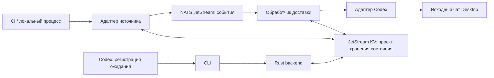

# Архитектура

Статус: проект на основе [принятого стека](../adr/0001-rust-nats-jetstream.md). Реализация отсутствует.

## Цель и границы

Пользователь заранее разрешает продолжение работы после конкретной задачи. Codex регистрирует ожидание и завершает ход. Локальная служба принимает результат и доставляет его в исходный чат. Следующий ход модели начинается только при доставке, если транспорт и состояние чата позволяют это.

Первая версия рассчитана на локальный Mac и пользовательскую сессию. Она не выводит компьютер из сна, не работает на выключенном компьютере и не заменяет CI-систему. Восстановление событий, возникших во время недоступности Mac, зависит от истории или API источника.

## Компоненты

CLI и служба предлагаются как режимы одного бинарника. Адаптер источника и обработчик доставки работают внутри службы. NATS — отдельный процесс. Диаграмма показывает логические связи; протокол CLI → служба пока не выбран.

| Компонент | Ответственность | Не отвечает за |
|---|---|---|
| [Backend](../modules/backend/README.md) | Регистрация, состояние, доставка и сверка после рестарта | Выполнение рассуждений модели |
| [Источники](../modules/sources/README.md) | Наблюдение за задачей, нормализация результата | Выбор чата и продолжения |
| [Codex delivery](../modules/codex-delivery/README.md) | Адресация и классификация ответа Codex | Успех исправления CI |
| NATS JetStream | Хранение и повторная выдача сообщений по настройкам | Исполнение задач и транзакция с Codex |
| Скилл, в будущем | Регистрация ожидания с контекстом пользователя | Бесконечный опрос модели |

## Основной поток

1. Сохранить привязку задачи к чату и заранее разрешённому продолжению до успешного ответа на регистрацию.
2. Наблюдать конкретный запуск задачи, не запуская его повторно при восстановлении службы.
3. Опубликовать нормализованный результат и получить подтверждение брокера.
4. Прочитать событие, проверить состояние ожидания и зафиксировать попытку до обращения к Codex.
5. Сохранить подтверждение приёма или неоднозначный результат. Подтвердить обработку сообщения только после устойчивой записи решения.
6. Codex продолжает работу в рамках разрешённого поручения. Принятое сообщение ещё не доказывает выполнение поручения.

Алгоритм с окнами падения принадлежит [backend lifecycle](../modules/backend/lifecycle.md).

## Ожидание и цикл исправления CI

Подписки, долгие сетевые ожидания, переподключения и таймеры выполняет Rust-код. Polling источника допустим только как явно выбранный режим адаптера; это не полная push-модель, но он не вызывает модель.

После неуспешной сборки агент может исправить код, запустить новый CI и зарегистрировать новое ожидание. Это новое действие с новым идентификатором запуска. Бюджет попыток, условия остановки и разрешение на изменения задаются пользователем; служба не разрешает бесконечный цикл сама.

## Граница доверия

Сохраняем целевой чат и разрешённое продолжение отдельно от результата источника. CI-логи, ошибки и артефакты считаются данными. Подстановка текста лога не должна превращаться в shell-команду или новую инструкцию от пользователя. Отмена и более поздние указания пользователя имеют приоритет перед ранее сохранённым продолжением.
